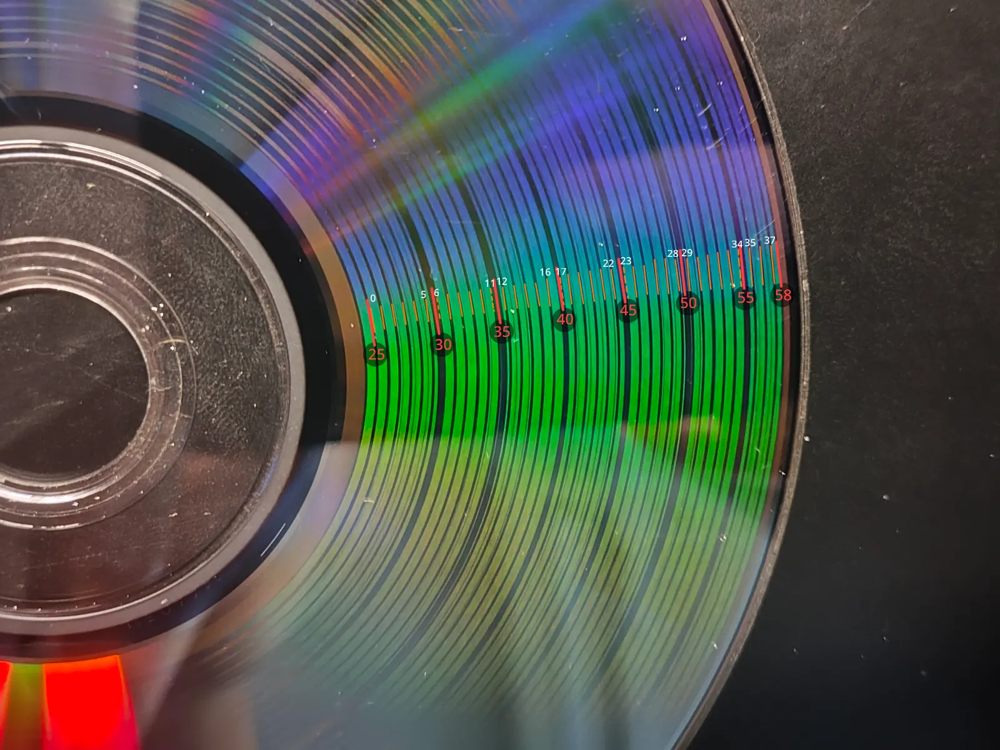

# Calibration Process
符號約定：從資料面觀看，順時針方向為正。

### 核心概念
光碟螺旋軌跡由三個基本幾何引數構成：起始半徑 ($r_0$)、軌距 ($p$) 與總圈數 ($N$)。校準的目標是讓燒錄出的直線輻條對齊徑向：
- **$N$（總圈數）誤差**：會導致輻條從內到外產生單向的螺旋纏繞。
- **$p$（軌距）誤差**：會導致輻條呈現「弓形」（C 形）彎曲。
- **區域性殘差**：通常會呈現「S 形」彎曲，需透過在 Profile 中寫入修正表來補償。

### 校準影像
- `spoke-no-ring`：無圓環。僅在扭曲極度嚴重、圓環會干擾視線時使用。
- `spoke-thin-ring`：含 25–55 mm（每 5 mm 步進）的 0.2 mm 細環。
- `spoke-full`：含 25–55 mm（每 5 mm 步進）的 0.5 mm 粗環，以及每 1 mm 步進的 0.05 mm 細環。用於高密度殘差測量與半徑校準，也可用於初始擬合。

## 校準實例流程
以下我們以一張 **Verbatim DVD+RW 4x (MID: MKM/A02)** 光碟為例，示範如何從零開始完成整個校準過程。

## 1. 初始幾何引數
先固定標稱 $r_0$，使用現有 Profile 中的基本幾何引數或以下預設值燒錄第一張光碟：
- **CD (80 min)**：$r_0=25.00\ \text{mm},\ p = 1.51\ \mu\text{m},\ N=22110.0$
- **DVD (4.7 GB)**：$r_0=24.00\ \text{mm},\ p = 0.74\ \mu\text{m},\ N=46000.0$

這裡我們採用 DVD 的預設幾何引數，建立初始設定檔 `step0_init.json` （此時尚未進行任何補償，因此 `correction` 設為 `null`）：
```json
{
    "disc": {
        "type": "DVD+RW",
        "capacity_sectors": 2295104
    },
    "geometry": {
        "r0_mm": 24.0,
        "pitch_um": 0.740,
        "n": 46000.0
    },
    "correction": null
}
```

## 2. 粗調階段
**使用影像**：`spoke-full` 或 `spoke-no-ring`

### 做法 A（推薦：同時擬合 $N$ 與 $p$）
使用帶有圓環的影像（如 `spoke-full`）配合 `step0_init.json` 燒錄第一張光碟。即使初始引數讓輻條過度扭曲，半徑圓環通常依然清晰可見。我們可以估讀每個半徑位置上輻條累積轉了多少圈，輸入到 Fitting 工具中同時計算出修正後的 $N$ 和 $p$，這能大幅縮短後續校準過度扭曲 $p$ 的時間。



初始引數 `step0_init.json` 的燒錄結果如圖所示。

從內圈往外圈看，勉強能看出螺旋有逆時針趨勢。（從螺旋往逆時針看，會注意到螺旋距離外側圓環的距離逐漸靠近）

圖中標記所示從 25 mm 半徑處開始向外讀數，紅色實線為半徑圓環，橙色實線為從內到外讀到的一圈螺旋，橙色虛線為根據兩側實線密度估讀的螺旋位置。

我們將照片中各個半徑圓環上估讀的累積圈數整理到 `coarse_meas.json` 檔案中：

```json
{
    "unit": "rev",
    "ref_radius": 25.0,
    "samples": [
        [25.0,  -0.0],
        [30.0,  -5.7],
        [35.0, -11.3],
        [40.0, -16.9],
        [45.0, -22.7],
        [50.0, -28.5],
        [55.0, -34.2],
        [58.0, -37.5]
    ]
}
```

接著執行以下指令，計算新的 $N$ 和 $p$ 並套用到新的 Profile (`step1_coarse.json`) 中：

```bash
discscape profile fit step0_init.json step1_coarse.json -m coarse_meas.json
```

執行後，`step1_coarse.json` 中的 `geometry` 會更新為初步收斂後的數值。

```json
"geometry": {
    "r0_mm": 24.0,
    "pitch_um": 0.7406477102138135,
    "n": 45961.25586730827
}
```

隨後使用 `step1_coarse.json` 重新燒錄一張光碟，檢視修正效果。

### 做法 B（單獨調整 $N$）
若扭曲極度密集導致圓環干擾判讀，可改燒錄 `spoke-no-ring` 影像，直接觀察輻條從內到外旋轉的總圈數 $m$。順時針旋轉則將 $N$ 加 $m$，逆時針則減 $m$。

### 進入下一階段的條件
當整體扭轉圈數已經足夠小（例如小於 1~2 圈），或者扭曲中開始出現明顯的「弓形」畸變時，說明 $N$ 已不再是誤差中的主導部分，即可進入細調階段。

## 3. 細調階段
**使用影像**：`spoke-thin-ring` 或 `spoke-full`

使用粗調後的 Profile 燒錄影像。此時輻條已不再劇烈纏繞，但通常會帶有明顯的「弓形」彎曲。請從最內圈根部開始，數出每個半徑圓環（僅需讀取 5 mm 步進）上輻條累積轉了多少圈（含小數）或偏移角度並記錄下來，若內圈根部模糊無法辨識，請選擇一個能看清的半徑 $r_z$（設定為 `ref_radius`）作為基準，記錄其他半徑相對該基準轉了多少圈或多少度。


上一輪 `step1_coarse.json` 的燒錄結果如圖所示。

從上圖可以看到，輻條呈現典型的伴隨整體逆時針趨勢的弓形彎曲。這裡我們從根部開始測量誤差。將照片中量測到的 5 mm 步進偏移資料整理到 `fine_meas.json` 檔案中。

```json
{
    "unit": "deg",
    "samples": [
        [24.0,   0.0],
        [25.0,  -6.1],
        [30.0, -31.2],
        [35.0, -45.5],
        [40.0, -52.8],
        [45.0, -55.1],
        [50.0, -53.6],
        [55.0, -48.9],
        [58.0, -45.2]
    ]
}
```

接著執行以下指令，計算新的 $N$ 和 $p$ 並套用到新的 Profile (`step1_coarse.json`) 中：

```bash
discscape profile fit step1_coarse.json step2_fine.json -m fine_meas.json
```

更新後的 `step2_fine.json` 幾何引數如下：
```json
"geometry": {
    "r0_mm": 24.0,
    "pitch_um": 0.7406274086768417,
    "n": 45961.12864386908
}
```

使用新的 Profile 重新燒錄。

重複上述步驟直到輻條大致對齊徑向方向。當弓形彎曲已經消除、結果已經足夠好（僅剩下微小的 S 形區域性誤差）時，即可進入最後一步。

## 4. 殘差修正
**使用影像**：`spoke-full`

即便 $N$ 與 $p$ 已經完全收斂，由於光碟軌距的局部微小變化或燒錄機特性，輻條通常仍會帶有微小的「S 形」彎曲。此時請燒錄 spoke-full 影像，並透過照片讀取每個 1 mm 步進半徑上，相對於根部（或基準半徑）旋轉的圈數、角度、或偏移的切線弧長 (`arc_mm`)。