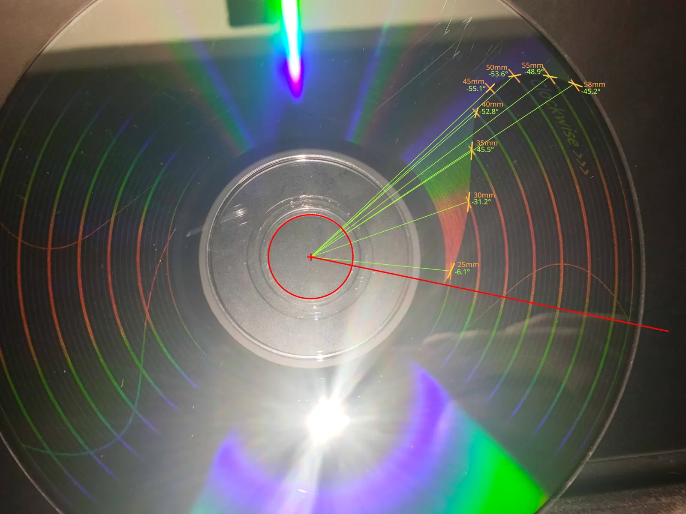

# Calibration Process
**English** | [繁體中文](./calibration-process.zh-Hant.md)

Sign convention: Viewed from the data side, the clockwise direction is positive.

### Core Concepts
An optical disc's spiral track is defined by three basic geometric parameters: starting radius ($r_0$), track pitch ($p$), and total number of turns ($N$). The goal of calibration is to align the burned straight spokes along the radial direction:  
- **$N$ error** (total turns): Causes the spokes to wind spirally in a single direction from the inner to the outer region.
- **$p$ error** (track pitch): Causes the spokes to exhibit a "bow-shaped" (C-shaped) curvature.
- **Local residuals**: Typically appear as an "S-shaped" curvature, compensated by writing a correction table into the profile.

### Calibration Images
- `spoke-no-ring`: No rings. Used only when distortion is extremely severe and the rings would obstruct visibility.
- `spoke-thin-ring`: Contains 0.2 mm thin rings from 25–55 mm in 5 mm steps.
- `spoke-full`: Contains 0.5 mm thick rings (25–55 mm, 5 mm steps) and 0.05 mm thin rings (1 mm steps). Used for high-density residual measurement, radius calibration, and initial fitting.

## Calibration Walkthrough Example
Below, we use a **Verbatim DVD+RW 4x** (MID: MKM/A02) disc as an example to demonstrate how to complete the entire calibration process from scratch.

## 1. Initial Geometric Parameters
First, fix the nominal $r_0$ and burn the first disc using the basic geometric parameters from an existing profile or the following default values:
- **CD (80 min)**: $r_0$ = 25.00 mm, $p$ = 1.51 μm, $N$ = 22110.0
- **DVD (4.7 GB)**: $r_0$ = 24.00 mm, $p$ = 0.74 μm, $N$ = 46000.0

Here, we adopt the default DVD geometric parameters to create the initial configuration file `step0_init.json` (since no compensation has been applied yet, `correction` is set to `null`):

```json
{
    "disc": {
        "type": "DVD+RW",
        "capacity_sectors": 2295104
    },
    "geometry": {
        "r0_mm": 24.0,
        "pitch_um": 0.740,
        "n": 46000.0
    },
    "correction": null
}
```

## 2. Coarse Tuning Stage
**Images used**: spoke-full or spoke-no-ring

### Method A (Recommended: Fit $N$ and $p$ Simultaneously)
Burn the first disc using an image with rings (such as spoke-full) together with `step0_init.json`. Even if the initial parameters cause severe spoke distortion, the radius rings usually remain clearly visible. We can estimate the cumulative number of turns of the spokes at each radial position and feed these readings into the fitting tool to compute the corrected $N$ and $p$ simultaneously, which substantially reduces the time needed to calibrate a heavily distorted $p$ later on.


The burn result from the initial parameters in `step0_init.json ` is shown in the figure.

Viewing from the inner ring toward the outer ring, a counterclockwise winding trend in the spiral is barely discernible (following the spiral in the counterclockwise direction, notice that the distance between the spiral line and the outer radius ring gradually decreases; therefore, subsequent revolution readings are recorded as negative values).


As marked in the figure, we take readings outward starting from the 25 mm radius:
- **Solid red lines**: Mark the reference positions of each radius ring in mm.
- **Solid orange lines**: Integer-turn spiral positions clearly visible from inside to outside.
- **Dashed orange lines**: Integer-turn positions obscured by overlapping 0.5 mm thick rings, interpolated from the spacing density of adjacent solid lines.

We compile the estimated cumulative revolutions at each radius ring from the photo into the `coarse_meas.json` file:

```json
{
    "unit": "rev",
    "ref_radius": 25.0,
    "samples": [
        [25.0,  -0.0],
        [30.0,  -5.7],
        [35.0, -11.3],
        [40.0, -16.9],
        [45.0, -22.7],
        [50.0, -28.5],
        [55.0, -34.2],
        [58.0, -37.5]
    ]
}
```

Next, run the following command to calculate the new $N$ and $p$ and apply them to a new profile (`step1_coarse.json`):

```bash
discscape profile fit step0_init.json step1_coarse.json -m coarse_meas.json
```

After execution, `geometry` in `step1_coarse.json` updates to the initially converged values:

```json
"geometry": {
    "r0_mm": 24.0,
    "pitch_um": 0.7406477102138135,
    "n": 45961.25586730827
}
```

Then burn a new disc using `step1_coarse.json` to inspect the correction results.

### Method B (Adjust $N$ Individually)
If the distortion is so dense that the rings interfere with reading, burn the `spoke-no-ring` image instead and directly observe the total number of turns $m$ that the spokes rotate from inside to outside. Add $m$ to $N$ for clockwise rotation, or subtract $m$ for counterclockwise rotation.   

### Criteria for Entering the Next Stage
Once the overall number of twisted turns is sufficiently small (for example, less than 1–2 turns), or a distinct "bow-shaped" distortion begins to appear within the twist, $N$ is no longer the dominant component of the error, and you can proceed to the fine tuning stage.

## 3. Fine Tuning Stage
**Images used**: `spoke-thin-ring` 或 `spoke-full`

Burn the image using the coarse-tuned profile. At this stage, the spokes no longer wind severely, though they typically carry a noticeable "bow-shaped" curvature. Starting from the innermost root, count and record how many cumulative turns (including decimals) or degrees of angular offset the spokes have rotated at each radius ring (reading only at 5 mm steps is needed); if the inner root is blurry and unreadable, choose a clearly visible radius $r_z$ (set as `ref_radius`) as the reference and record how many turns or degrees the other radii rotate relative to that reference.



The burn result from the initial parameters in `step1_coarse.json` is shown in the figure.

As seen in the figure above, the spokes exhibit a classic bow-shaped curvature accompanied by an overall counterclockwise trend. Here, we measure the error starting from the **root** and compile the 5 mm increment offset data measured from the photo into the `fine_meas.json` file:

```json
{
    "unit": "deg",
    "samples": [
        [24.0,   0.0],
        [25.0,  -6.1],
        [30.0, -31.2],
        [35.0, -45.5],
        [40.0, -52.8],
        [45.0, -55.1],
        [50.0, -53.6],
        [55.0, -48.9],
        [58.0, -45.2]
    ]
}
```

Next, run the following command to calculate the new $N$ and $p$ and apply them to a new profile (`step2_fine.json`):

```bash
discscape profile fit step1_coarse.json step2_fine.json -m fine_meas.json
```

The updated geometric parameters in `step2_fine.json` are as follows:

```json
"geometry": {
    "r0_mm": 24.0,
    "pitch_um": 0.7406274086768417,
    "n": 45961.12864386908
}
```

Burn again using the new profile.

Repeat the steps above until the spokes are roughly aligned with the radial direction. Once the bow-shaped curvature is eliminated and the result is good enough (leaving only minor S-shaped local errors), you can proceed to the final step.

## 4. Residual Correction
**Image used**: `spoke-full`

Even when $N$ and $p$ have fully converged, the spokes usually retain a slight "S-shaped" curvature due to minor local variations in the disc's track pitch or drive characteristics. At this point, burn the `spoke-full` image and read from the photo—at each 1 mm radius increment—the number of turns, angle, or tangential arc length offset (`arc_mm`) rotated relative to the root (or reference radius).