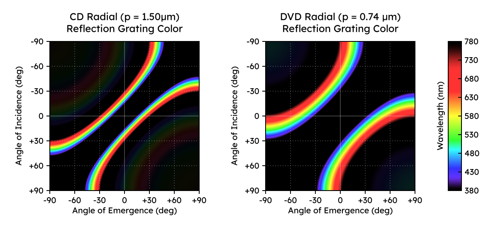

# 光学原理指南
在光碟的资料面上作画，本质上是把图像转换成不同特征的数据流刻录到盘面上。为了直观理解「选择不同的码字，画面在不同角度下会呈现什么颜色」，文本将从光碟的物理结构出发，定性解析切向光学特征与视角规律。

## 1. 径向和切向
光碟表面有一条从内圈螺旋延伸到外圈的轨道，这条轨道在光学上构建了两个彼此垂直、分工完全不同的绕射光栅：
### 径向 (Radial)
- **主导结构**：轨道与轨道之间的固定间距（CD 约为 1.5~1.6 μm，DVD 约为 0.74 μm）
- **可刻录光碟的物理基础**：即使是空白的 CD-R/RW 光碟或 DVD R/RW 光碟，出厂时塑料基板上便已压印好了螺旋形的**预刻录凹槽** (pre-groove)，部分格式如 DVD-R/-RW 在槽间还带有用于寻址的预刻录凹坑 PLL。因此，光碟在刻录前就已经具备了固定的径向绕射能力，这也是为什么空白光碟对着灯看也会出现彩虹。
- **特征**：径向光栅的间距出厂即固定，刻录数据无法改变它。

### 切向 (Tangential)
- **主导结构**：沿轨道前进方向分布的 Pit 和 Land 序列。在 R/RW 盘片上，这对应激光沿预刻录凹槽烧蚀出的染料变色区 / 相变区和未烧蚀区的交替排列。
- **特征**：切向的 Pit / Land 排列完全由我们写入的数据内容决定，这是 Disc Art 能够表现出宏观图像的核心。

## 2. 控制 Pit / Land 的排列

数据在写入光碟前，会经过 EFM (CD) 或 EFMPlus (DVD) 调变编码。
- 调变编码规定，一次连续的 Pit 或 Land 长度（切换间隔）不能太短也不能太长，必须落在 3T 到 11 T 之间（T 为单个通道位元的长度，CD 约为 278 nm，DVD 约为 133 nm），且长期看来 Pit 和 Land 必须保持大致 50/50 的面积平衡。

虽然我们无法「纳米级」任意画线，但由于编码映射关系是确定的：
- 我们可以故意构造出特定的源字节序列，让编码器连续输出大量「高频切换（短 Pit + 短 Land）」或「低频切换（长 Pit + 长 Land）」的码字，从而在宏观上控制某一区域的 Pit/Land 的切换密度。
- **名义码长 (Nominal T)**: 受限于帧同步头（Sync）、CD 的合并位元（Merging bits）以及 50/50 直流平衡，真实刻录近盘面的码流几乎不可能纯粹由单一的 3T 或 8T 组成——例如，在主导 3T 的序列中会夹杂 4T 过渡段。因此，在这里，我们使用 **3T Nominal**、**8T Nominal** 来指代以该长度为主导的纹理区域。

## 3. 光栅特征与视角规律

在具体看 3T 和 8T 的区别之间，首先介绍一些关于光栅的核心定性规律。

#### 光栅周期越短，衍射光越远离法线（色散越开）
在相同的光照角度下，Pit / Land 切换越密集（等效光栅长度越小）：
- 衍射光偏折的角度就越大，越远离镜面反射中心，彩虹带也被拉开得更宽。
- 反之，切换越稀疏（周期越大），光束就越向镜面反射中心收拢，彩虹带会变窄挤在一起。

#### 斜向照射时「一侧甩出」
当光线从正上方垂直照射（入射角 0°）时，两侧的衍射光是对称的。但当光源倾斜，入射角越来越远离法线时，镜面反射两侧的反射光会发生不对称偏移：
- **远侧（-m 阶）远离法线**：越过镜面反射另一侧的衍射光进一步靠近盘面（90°），很快就会掉出视野消失。
- **近侧（+m 阶）靠近法线**：靠近入射同侧或法线方向的衍射光，会被倾斜角拉回法线附近。

### Incidence (入射) / Emergence (出射) 窗口图
在接下来的分析中，我们使用视角窗口图来直观展示每种纹理的可见范围。

- **坐标轴**：纵轴为**入射角**（-90° ~ +90°），横轴为**出射角/观察角**（-90° ~ +90°）；像素颜色代表在该角度组合下能看到的衍射光颜色。
- **对角线黑带**：贯穿画面的黑色斜带是**镜面反射线**（0 阶反光，无色散）
- **对角线对称**（光路可逆）：把整张图沿着对角线转置对称——把光源位置和观察位置互换，看到的颜色完全相同。
- **纯黑区域**：视野盲区，该角度下没有可见光衍射。

如图所示的是 CD 和 DVD 在**径向**上的窗口图。我们可以看到:
- 沿镜面反射轴从左下到右上的中央黑色斜带为 0 阶镜面反射线，两侧为第 1 阶彩虹带；整张图沿左上-右下对角线转置对称（光路可逆）
- **尺度对比**：DVD 轨距（0.74 μm）约为 CD 轨距（1.50 μm）的一半，因此其色散明显更宽、更远离镜面反射轴
  - CD 角落可见第 3 阶彩虹带，在 DVD 上的第 3 阶彩虹带几乎被完全推至视野外。
- **斜射效应**：沿纵轴将入射角从 0° 下移至 +60° 时，可以看到一侧的彩带迅速掉出 -90° 视野盲区，另一侧则被拉至 0° 法线附近。

## 4. 三种典型状态的对比
